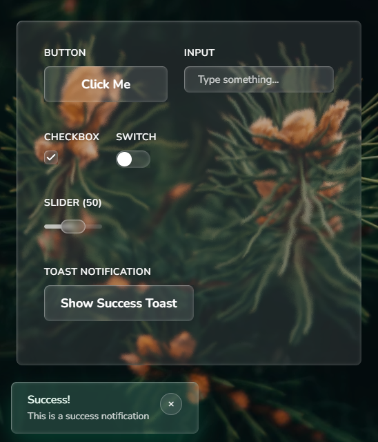

# react-magic-ui
[](https://www.npmjs.com/package/react-magic-ui)
[](https://www.npmjs.com/package/react-magic-ui)
[](https://github.com/tweeedlex/react-magic-ui/blob/main/LICENSE)
[](https://github.com/tweeedlex/react-magic-ui/stargazers)
[](https://github.com/tweeedlex/react-magic-ui/issues)
[](https://github.com/tweeedlex/react-magic-ui/blob/main/CONTRIBUTING.md)

Liquid glass React components in the style of Apple iOS 26. Plain CSS, typed, with JSDoc on every prop.



### [🚀 Live demo](https://react-magic-ui-demo.netlify.app/) · [📚 Storybook](https://react-magic-ui-docs.netlify.app/)

## Installation

```bash
npm install react-magic-ui
```

Import the styles once, at your app entry (`main.tsx`, `app/layout.tsx`, `_app.tsx`):

```ts
import "react-magic-ui/style.css";
```

Works with React 18 and 19. The bundle is marked `"use client"`, so it drops into the Next.js app router as is.

## Usage

```tsx
import { Button, Card, Switch } from "react-magic-ui";

function Settings() {
  const [wifi, setWifi] = useState(true);
  return (
    <Card>
      <h3>Settings</h3>
      <Switch aria-label="Wi-Fi" checked={wifi} onCheckedChange={setWifi} />
      <Button variant="prominent">Done</Button>
    </Card>
  );
}
```

Glass needs something behind it: put the UI over an image, video or gradient.

## Using it with AI agents

The package ships [`llms.txt`](./llms.txt): setup, the iOS 26 rules (no glass on glass, one prominent action, red only for destructive), and a copy-paste example for every component. Point your agent at `node_modules/react-magic-ui/llms.txt`, or add a line like this to your `AGENTS.md` / `CLAUDE.md`:

```md
UI components come from react-magic-ui. Read node_modules/react-magic-ui/llms.txt before using them.
```

## Components

- **Button** — `glass` and `prominent` styles, `destructive` role, custom `tint`
- **Badge** — glass label or red notification count
- **Card** — glass or frosted panel for content
- **Input** — capsule text field with icons
- **Switch**, **Checkbox**, **Slider**, **Select** — controls with one naming scheme (`checked`/`onCheckedChange`, `value`/`onValueChange`)
- **Tabs** — segmented control with a sliding pill
- **Modal** — sheet that keeps the page scrollbar
- **Toast** — `ToastProvider` + `useToast()`
- **Topbar**, **Sidebar** — navigation bars
- **GlassText** — glass glyphs, like the iOS 26 lock screen clock
- **Glass** — the material itself, for your own surfaces

## Theming

- Dark theme: class `dark` (or `data-theme="dark"`) on any ancestor.
- Text colour on glass: `tone="light" | "dark"` on a component, or `data-glass-tone` on any ancestor.
- Colours are CSS variables: `--rmu-accent`, `--rmu-blue`, `--rmu-green`, `--rmu-red`, `--rmu-orange`, `--rmu-gray`, `--rmu-font`.

> The rim refraction (lens) needs Chromium. Safari and Firefox get the same glass without the bend at the edge.

## Featured In
- 📰 [[Medium] JavaScript in Plain English](https://javascript.plainenglish.io/react-magic-ui-e4289a3a0e8b)

## Development

```bash
# Install dependencies
npm install

# Run Storybook
npm run storybook

# Build library
npm run build

# Run tests
npm test
```

## Contributing
Please read the [contributing guide](/CONTRIBUTING.md).


## License

MIT © [@tweeedlex](https://github.com/tweeedlex)

### Third-party

- Icons from [Framework7 Icons](https://github.com/framework7io/framework7-icons), MIT © Vladimir Kharlampidi.
- [Inter](https://rsms.me/inter/) font via [Fontsource](https://fontsource.org/fonts/inter), SIL Open Font License 1.1.